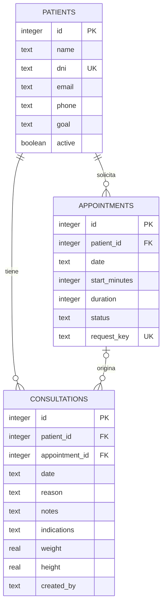

# Modelo de datos

D1 utiliza SQLite. El esquema se declara en `db/schema.ts` y se crea con la migración SQL versionada en `drizzle/`.

## Tablas

- `patients`: identidad ficticia, contacto, edad, antecedentes, objetivo y estado. DNI opcional; los no vacíos son únicos. Las solicitudes públicas generan un registro nuevo sin consultar/exponer otros pacientes.
- `appointments`: paciente, fecha, minutos desde medianoche, duración, modalidad, estado y origen. Las solicitudes web guardan clave idempotente y código de comprobante.
- `consultations`: paciente, turno opcional, fecha, motivo, observaciones, objetivos, indicaciones, métricas y autor autenticado. Las consultas finalizadas no se sobrescriben.
- `schedule_blocks`: fecha, comienzo, duración y motivo de no disponibilidad.
- `app_state`: revisión de la información compartida. Evita aceptar un guardado basado en una versión vieja.

## Integridad

- Claves foráneas: un turno o consulta no puede referenciar un paciente inexistente.
- Estados de turno validados por `CHECK`.
- Duración, edad y métricas con restricciones de rango.
- Triggers impiden solapamiento de turnos confirmados/atendidos y bloqueos.
- Las solicitudes pendientes pueden coincidir: son preferencias por revisar. Solo una puede confirmarse en el mismo horario.
- Crear solicitud y paciente, y guardar consulta/estado del turno, usan transacciones D1 `batch()`.
- Las modificaciones se guardan mediante sentencias preparadas con parámetros, sin concatenar entradas del usuario al SQL.

## Estados

| BD | Interfaz |
|---|---|
| pendiente | Programado · Sin confirmar |
| confirmado | Programado · Confirmado |
| atendido | Atendido |
| cancelado | Cancelado |
| ausente | No asistió |

Confirmación y asistencia son eventos distintos. Confirmar no significa que el paciente haya asistido.
