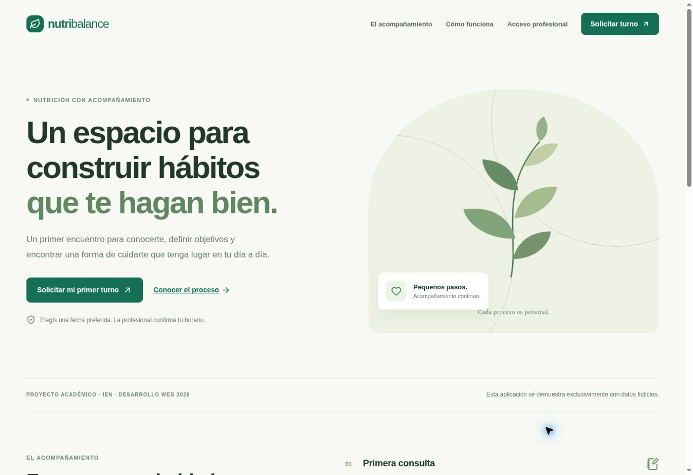

# Verificación y pendientes de entrega

## Pruebas automáticas

- Dominio: fechas reales/bisiestas, solicitud ficticia, correo, horario, estados, medidas, tamaños e identificadores.
- BD: aplicar el SQL real en SQLite; FK, DNI único, turnos contiguos/superpuestos, confirmación sobre pendiente, bloqueos, inmutabilidad y rollback de revisión antigua.
- Integración del Worker: ejecutar el build en Miniflare con D1 aislada; 401/403, solicitud idempotente, confirmación, consulta, atendido y recarga.
- TypeScript y build de producción.

La ejecución de cada prueba debe verificarse antes de presentar su resultado como aprobado.

## Revisión SEO implementada

- Landing y solicitud tienen `title`, meta description, canonical y contenido HTML renderizado en servidor.
- `lang="es-AR"`, jerarquía de encabezados y navegación semántica.
- `robots.txt` y sitemap incluyen solo las páginas públicas pertinentes.
- Panel, acceso y prototipos llevan `noindex`.
- Ilustración SVG decorativa, sin petición de imagen pesada ni fotografía de una persona inventada.
- CSS responsive, foco visible, enlace de salto y movimiento reducido.

## Pendiente antes de entregar

1. Revisión complementaria en un teléfono físico y contraste con herramienta específica.
2. Reporte Lighthouse/PageSpeed en una URL pública accesible. No se declara una puntuación no medida.
3. Publicar el repositorio en GitHub con historial y participación del equipo.
4. Habilitar la audiencia pública del sitio si el propietario lo autoriza; el panel mantiene su autorización propia.
5. Adjuntar prototipo y análisis, modelo, documentación final y uso de IA.
6. Ensayar el flujo con las cuentas autorizadas que se usarán en la defensa.

La URL del sitio, la audiencia de hosting y la autorización del panel son tres cuestiones distintas. Un sitio publicado con audiencia privada todavía no acredita el requisito de URL pública del TP.

## Evidencia previa conservada

Estos resultados proceden de la iteración anterior. No equivalen a una nueva ejecución en este equipo:

- 7 pruebas de dominio aprobadas.
- 7 pruebas de integridad SQL aprobadas.
- Prueba de integración sobre el Worker compilado con D1 aislada: aprobada para autorización, solicitud, idempotencia, confirmación, conflicto de versión, consulta y recarga.
- Navegador de escritorio: solicitud ficticia enviada desde el formulario y comprobante pendiente observado. Se verificó su fila en la BD local.
- Navegador de escritorio: formulario de consulta y visualización del motivo, observaciones e indicaciones en el historial del prototipo visual.
- Corrección durante QA: el identificador idempotente se genera con `getRandomValues`, compatible con el preview HTTP; no depende de `randomUUID` disponible únicamente en contextos seguros del navegador.
- No se ha medido una puntuación Lighthouse/PageSpeed ni realizado una prueba en un teléfono físico.

- Responsive observado en navegador mediante marcos de 390 × 844 px: inicio, solicitud y panel sin desbordamiento horizontal. Es una revisión de viewport, no una prueba en teléfono físico. La ruta temporal de QA se quitó antes del deploy.
- Comprobación SEO sobre el HTML servido por el Worker: un H1 en inicio, description, canonical, sitemap público y robots. No equivale a una puntuación Lighthouse.

## Captura de la página pública

Captura del preview revisado. El endpoint y la BD se verificaron aparte con las pruebas de integración.

## Verificación del 26 de octubre de 2026

La revisión parte del commit `8d56c797ab281f2858ba8982a36f0cce6e18a111`. Se ejecutaron estos controles sobre los cambios de cierre:

| Control | Resultado |
|---|---|
| TypeScript (`pnpm exec tsc --noEmit`) | Aprobado |
| Dominio y cliente HTTP (`pnpm test`) | 10 pruebas aprobadas |
| Migración en SQLite (`python3 tests/database_test.py`) | 7 pruebas aprobadas |
| Build de producción | Aprobado con Vinext/Vite en Windows |
| Worker compilado + D1 aislada | Aprobado: permisos, solicitud, idempotencia, confirmación, revisión, consulta, atendido y recarga |
| Reintento con otra hora en el formulario | Devuelve la hora original guardada, sin crear otro paciente/turno |
| Consulta sin comando separado de asistencia | El servidor cambia el turno a atendido |
| Consulta inválida | No agrega registros ni cambia la revisión |
| Conflicto de revisión | HTTP 409 y `Cache-Control: no-store` |
| Sesión vencida | Pruebas del cliente preservan 401 y verifican un solo envío, sin reintento automático |
| API Express externa | Bloqueada: HTTP 530, Cloudflare 1033 en CSRF y disponibilidad |
| D1 desplegada | Tablas presentes; pacientes, turnos y consultas vacíos al inspeccionarlos |
| Navegador y responsive de esta iteración | Sin verificar: el inventario de navegadores de automatización está vacío |
| Lighthouse/PageSpeed | Pendiente; no se atribuye una puntuación |

Las pruebas de Worker ejecutan SQL real en D1 local aislada. No constituyen una prueba de producción ni de PostgreSQL. La cuenta de preview y `.dev.vars` son ficticias, locales e ignoradas por Git.

La instalación inicial venció durante descargas y se reanudó con la caché y un tiempo de espera mayor, sin cambiar las versiones del lockfile. En este equipo el runner de Node y el build necesitaron ejecución fuera de la restricción que impedía crear procesos; los primeros fallos de `spawn EPERM` no fueron fallos de las reglas de negocio.
